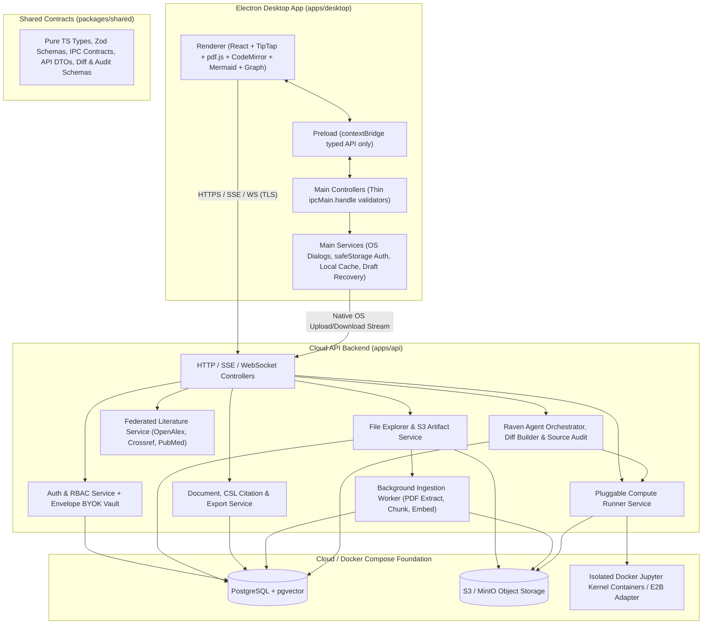
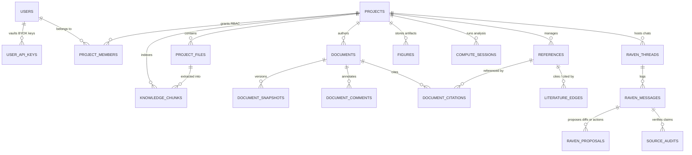

# Sunrise — Master Architecture & Multi-Phase Implementation Plan

> [!IMPORTANT]
> **Status:** Stage 1 Architecture & Implementation Plan (Pre-Implementation, Awaiting Human Gate Approval)  
> **Target Repository:** `C:\Users\sxpix\Documents\CODES\Projects\sunrise` (verified empty greenfield directory)  
> **Author:** Horizon (Systems Analyst & Architect — Stage 1: Contract & Test Agent)  
> **Process Standard:** Electron Software Factory (Stage 1 Contracts & Failing Tests -> Human Gate -> Stage 2 Implementation -> Stage 3 Verification)

---

## 1. Problem Statement & Product Philosophy

Academic researchers currently endure severe workflow fragmentation across disconnected tools: Google Scholar, browser PDF tabs, Zotero, Word/Google Docs, Excel, Jupyter/Python, citation formatters, diagramming apps, and standalone AI chat windows. Context is repeatedly lost between discovery, reading, analysis, and writing.

**Sunrise** is a **Full-Stack AI Research Workspace** ("VS Code/Cursor + Zotero + Google Docs + Jupyter + Research Copilot in one project-oriented environment") designed for university students, graduate/PhD researchers, independent researchers, research assistants (primary) and research labs, professors, data scientists, and scientific writers (secondary).

### Non-Negotiable UX Principles

1. **The Researcher Remains the Author:** Sunrise is a real academic word processor and research IDE, never an autonomous essay generator. Raven operates _alongside_ the researcher.
2. **Three-Column Interaction Model:**
   - **Left Sidebar (Project Artifacts):** Overview, References, Data, Analysis, Reports, Figures, All Files.
   - **Center (Dynamic Workspace):** Context-switched surface hosting the Academic Document Editor, PDF Viewer, Data Grid (CSV/XLSX), Code & Jupyter Notebook Editor, Image Viewer, Mermaid Diagram Editor, and Literature Map.
   - **Right Sidebar (Raven AI Assistant):** Explicit context pill controls, categorized academic action buttons, streaming agent reasoning/tool progress, Source Audit panel, and reviewable diff proposals.
   - **Foundation (Cloud Storage + Compute):** Cloud-hosted files, database, vector knowledge base, and isolated compute runtime accessed through an Electron desktop wrapper.
3. **Never Silently Overwrite Research:** Every document mutation proposed by Raven renders as an explicit reviewable diff (`Added paragraph, +38 words, +3 citations [Accept] [Reject]`).
4. **Explicit Context & Epistemic Rigor:** Users explicitly attach context pills (current doc, selection, PDFs, references, datasets, or Entire Project). Raven distinguishes **Supported**, **Partially Supported**, and **Unsupported** claims with file/page evidence pointers.

---

## 2. Locked Architectural Decisions

Every major design fork was resolved during the architectural discovery interview:

| #   | Decision Area                       | Locked Choice                                                                                      | Key Architectural Consequences                                                                                                                                                                                                                                             |
| --- | ----------------------------------- | -------------------------------------------------------------------------------------------------- | -------------------------------------------------------------------------------------------------------------------------------------------------------------------------------------------------------------------------------------------------------------------------- |
| 1   | **Storage & Compute Foundation**    | **Cloud-first with Electron wrapper**                                                              | Files, Postgres/pgvector indexing, and code execution run on cloud services; Electron provides desktop chrome, native OS file bridges, keychain, shortcuts, and local read-only resilience.                                                                                |
| 2   | **Repository Structure**            | **TypeScript Monorepo** (`apps/desktop`, `apps/api`, `packages/shared`)                            | Shared Zod schemas and TypeScript contracts across Electron and Cloud API; full local dev/test stack via Docker Compose (Postgres + `pgvector` + MinIO S3 + Compute).                                                                                                      |
| 3   | **Compute Sandbox**                 | **Pluggable Compute Runner** (Docker Jupyter Kernel containers + optional E2B/Modal cloud adapter) | Per-session container isolation for Python, Jupyter, ML, R, Node, and DuckDB SQL; streams outputs via WS/SSE; captures generated plots as Figure Artifacts; requires user approval before Raven runs code.                                                                 |
| 4   | **AI & Embeddings Model**           | **BYOK-only** (OpenAI, Anthropic, Gemini)                                                          | Backend proxies LLM and embedding requests using user-supplied keys; KB schema tracks per-project `embedding_provider`, `embedding_model`, and `embedding_dimensions` to handle model/dimension differences safely.                                                        |
| 5   | **BYOK Key Custody**                | **Envelope-encrypted Cloud Vault** (AES-256-GCM per-user vault)                                    | Enables asynchronous background KB indexing and multi-device access; keys are never returned in plaintext or written to logs.                                                                                                                                              |
| 6   | **Auth & Collaboration**            | **User Accounts + RBAC Sharing & Async Collaboration**                                             | Owner/Editor/Viewer roles, inline document comments, version snapshots, and optimistic concurrency autosave. Real-time CRDT multiplayer (Yjs) explicitly deferred beyond Phase 7.                                                                                          |
| 7   | **Document Editor & Citations**     | **TipTap (ProseMirror) JSON + KaTeX + CSL (`citeproc`)**                                           | Custom inline citation nodes (`@` autocomplete + `[@citekey]`), live APA/IEEE/MLA + extensible CSL styles, auto-updating bibliography, linked Figure nodes, inline Raven Accept/Reject diff marks, and export to PDF, DOCX, Markdown, and LaTeX.                           |
| 8   | **Electron Offline & Native Scope** | **Online-primary with graceful resilience**                                                        | Native OS file pickers, drag-and-drop upload, downloads, OS keychain (`safeStorage`) auth tokens, native menus/`Ctrl+P`, local read-only cache of recently opened docs/PDFs, and local draft recovery banner on disconnect.                                                |
| 9   | **Center Workspace Depth**          | **Focused research-grade editors**                                                                 | Full TipTap doc editor; `pdf.js` viewer (highlights + text-select to cite/Ask Raven); CSV/XLSX interactive data grid (sort/filter/edit/stats, no Excel macro engine); Monaco/CodeMirror code & notebook editor; Mermaid split-pane editor; DOCX import-to-native & export. |
| 10  | **PDF Metadata, Graph & Search**    | **Deterministic-first PDF pipeline + OpenAlex Graph + Pluggable BYOK Web Search**                  | PDF text/XMP + DOI regex -> Crossref/OpenAlex hydration -> BYOK LLM fallback if no DOI; OpenAlex citation/topic links for Literature Map; pluggable BYOK web search adapter (Tavily/Brave/SearXNG) alongside native OpenAlex/Crossref/PubMed.                              |
| 11  | **Raven Approval Policy**           | **Strict Tiered Approval**                                                                         | Read-only tools auto-run; document edits ALWAYS produce inline Accept/Reject diff proposals; side-effecting ops (code execution, file writes/deletes, saving references) require explicit per-action approval.                                                             |
| 12  | **Roadmap Structure**               | **8 Phases (Phases 0–7), 3–5 Sub-Phases each**                                                     | Vertically sliced milestones with explicit Stage 1/2/3 Factory gates and a trackable status matrix for both AI agents and human engineers.                                                                                                                                 |

---

## 3. System Architecture & Process Boundaries

### High-Level Topology

### Electron Software Factory Layer Invariants

Every file in the monorepo must obey strict boundary rules enforced by ESLint `no-restricted-imports`, TypeScript `strict: true`, and Stage 1 contract tests:

| Layer / Directory                    | Allowed Responsibilities                                                                                                                                          | Strictly Forbidden                                                               |
| ------------------------------------ | ----------------------------------------------------------------------------------------------------------------------------------------------------------------- | -------------------------------------------------------------------------------- |
| `packages/shared/`                   | Pure TypeScript types, Zod validation schemas, IPC channel maps, REST/SSE DTOs, citation/diff/audit contracts                                                     | Node built-ins, Electron, DOM, React, DB drivers, HTTP clients                   |
| `apps/desktop/src/main/controllers/` | Thin `ipcMain.handle` adapters that validate payloads with Zod, delegate to main services, and return typed `Result` objects                                      | Business logic, direct SQLite/file-cache queries, unvalidated `unknown` payloads |
| `apps/desktop/src/main/services/`    | Plain modular functions for OS file dialogs, drag-drop file streaming, `safeStorage` token custody, local read-only cache, draft recovery, window/menu management | Wrapper classes, UI state, cloud business rules                                  |
| `apps/desktop/src/main/db/`          | Local SQLite cache schema, migrations, and typed queries strictly for recently-opened read-only cache & unsaved offline draft recovery                            | Primary project source-of-truth data, business orchestration                     |
| `apps/desktop/src/preload/`          | Minimal `contextBridge.exposeInMainWorld("sunrise", api)` strictly typed against `packages/shared` IPC contracts                                                  | Exposing raw `ipcRenderer`, `fs`, `path`, `child_process`, or Node globals       |
| `apps/desktop/src/renderer/`         | React UI, 3-column workspace state, dynamic artifact editors, API/SSE client, keyboard shortcuts (`Ctrl+P`, `@`)                                                  | Node imports, Electron imports, direct DB access, raw IPC calls                  |
| `apps/api/src/controllers/`          | Thin HTTP/SSE/WS route handlers validating inputs with Zod, enforcing auth/RBAC middleware, calling domain services                                               | Business logic, inline SQL queries, direct SDK calls                             |
| `apps/api/src/services/`             | Domain orchestration (Literature federation, Bibliography, Document/CSL/Export, Raven Agent, Source Audit, KB RAG, Compute Runner, BYOK Vault)                    | Express/Fastify request objects, raw unparameterized SQL                         |
| `apps/api/src/db/`                   | PostgreSQL + `pgvector` SQL migrations, transactions, typed repositories                                                                                          | Business logic, HTTP transport concerns                                          |

> [!CAUTION]
> **Electron Security Baseline:** Every `BrowserWindow` MUST set `contextIsolation: true`, `nodeIntegration: false`, `sandbox: true`, `webSecurity: true`, and enforce a strict Content Security Policy (CSP). External links must validate `https:` / `http:` protocols before `shell.openExternal`.

---

## 4. Core Domain Data Model & Critical Contracts

### Relational & Vector Schema Overview

### Mandatory Core Entity Contracts

1. **Reference Record (`Reference`):**
   Minimum required fields per specification: `id`, `projectId`, `citeKey` (unique per project, e.g., `smith2024`), `title`, `authors[]` (structured family/given + display), `year`, `journal`, `published` (date/venue), `doi`, `url`, `abstract`, `volume`, `issue`, `pages`, `citationCount`, `pdfUrl`, `localPdfFileId` (S3-backed `PROJECT_FILES.id`), `tags[]`, `notes`, `sourceProvider` (`openalex | crossref | pubmed | doi | pdf | bibtex | ris | manual`), `createdAt`, `updatedAt`.
2. **Project Knowledge Base Configuration & Chunks:**
   - `projects.kbConfig`: `{ embeddingProvider: 'openai' | 'gemini', embeddingModel: string, embeddingDimensions: number, indexStatus: 'idle' | 'indexing' | 'needs_reindex' | 'error' }`.
   - `knowledge_chunks`: `id`, `projectId`, `fileId`, `referenceId?`, `pageNumber`, `chunkIndex`, `content`, `tokenCount`, `embedding` (`vector` scoped to project's active model), `embeddingModel`, `checksum`.
   - Changing a project's embedding provider/model marks existing chunks stale (`needs_reindex`) and triggers a clean background re-index using the user's vaulted BYOK key so vector dimensions never collide.
3. **Raven Context Pill Payload (`RavenContextRequest`):**
   - Explicitly controlled by the user: `activeDocumentId?`, `selectedText?` (`{ documentId, from, to, text }`), `attachedFileIds[]`, `attachedReferenceIds[]`, `attachedDatasetIds[]`, `includeEntireProjectKb: boolean`, `includeConversationHistory: boolean`, `enableLiteratureSearch: boolean`, `enableWebSearch: boolean`.
4. **Raven Reviewable Diff Proposal (`DocumentDiffProposal`):**
   - `proposalId`, `documentId`, `baseDocumentVersion`, `summary` (e.g., `"Added paragraph, +38 words, +3 citations"`), `metrics: { addedWords, removedWords, addedCitations, removedCitations }`, `operations[]` (TipTap node/range replacements), `status: 'pending' | 'accepted' | 'rejected' | 'stale'`.
   - Accepting verifies `baseDocumentVersion` matches current document version (or rebases/warns on stale state) and creates a pre-apply undo step + version snapshot.
5. **Raven Source Audit Contract (`SourceAuditReport`):**
   - Evaluates selected passage or full document claims against cited project references/chunks.
   - Each `ClaimAuditItem` returns: `claimText`, `citedKeys[]`, `verdict: 'supported' | 'partially_supported' | 'unsupported'`, `rationale`, `evidence[]` (`{ fileId, referenceId, pageNumber, excerpt, similarityScore }`).
6. **Raven Tiered Tool Approval Matrix:**

| Tool Category                    | Operations                                                                                                                       | Execution Policy                                                                                            |
| -------------------------------- | -------------------------------------------------------------------------------------------------------------------------------- | ----------------------------------------------------------------------------------------------------------- |
| **Read-Only**                    | Federated literature search, web search, KB semantic search, read attached files/PDFs/references/datasets, Source Audit analysis | Auto-execute; stream transparent tool status in Raven sidebar                                               |
| **Document Authoring**           | Improve paragraph, continue writing, summarize, expand, simplify, change tone, insert citation, insert figure                    | **Always** emit `DocumentDiffProposal` with inline diff preview + `[Accept]` / `[Reject]`                   |
| **Side-Effecting Workspace Ops** | Execute Python/SQL/Jupyter code, create/modify/delete files, save papers to project library, replace/delete figures              | Emit typed `ActionProposal` requiring explicit user click `[Approve]` / `[Reject]` before backend execution |

---

## 5. Draft Dependency Allowlist (`allowed-dependencies.json`) — Pending Human Gate

In compliance with Electron Software Factory governance, no third-party package will be installed until approved at the Human Gate. Below is the minimal, high-leverage stack proposed across phases:

| Workspace                    | Proposed Packages                                                                                                                                                                                                                                                                                                                                            | Purpose                                                                                                                                                                 | Rejected Alternatives & Why                                                                                                                                                                                                                  |
| ---------------------------- | ------------------------------------------------------------------------------------------------------------------------------------------------------------------------------------------------------------------------------------------------------------------------------------------------------------------------------------------------------------ | ----------------------------------------------------------------------------------------------------------------------------------------------------------------------- | -------------------------------------------------------------------------------------------------------------------------------------------------------------------------------------------------------------------------------------------- |
| **Monorepo / Tooling**       | `typescript`, `zod`, `vitest`, `@playwright/test`, `eslint`, `prettier`, `turbo` (or pnpm workspaces)                                                                                                                                                                                                                                                        | Strict static typing, runtime schema validation, unit/contract/E2E testing                                                                                              | Jest (slower TS/ESM integration than Vitest); Yup/Joi (weaker TS inference than Zod)                                                                                                                                                         |
| **Desktop (`apps/desktop`)** | `electron`, `electron-vite` (or Electron Forge + Vite), `react`, `react-dom`, `tailwindcss`, `better-sqlite3` (local cache only), `@tiptap/react`, `@tiptap/starter-kit`, `@tiptap/extension-table`, `katex`, `pdfjs-dist`, `@tanstack/react-table`, `@codemirror/view` (or `@monaco-editor/react`), `mermaid`, `cytoscape` (or `reactflow`), `lucide-react` | Secure Electron shell, 3-column academic IDE, TipTap editor, LaTeX, PDF viewer, data grid, code/notebooks, diagrams, Literature Map                                     | Slate.js (higher custom maintenance than TipTap/ProseMirror); HyperFormula/Univer (unnecessary Excel formula engine bloat); D3 raw SVG (slower graph interaction than Cytoscape/Sigma)                                                       |
| **Cloud API (`apps/api`)**   | `fastify`, `pg`, `drizzle-orm`, `pgvector`, `@aws-sdk/client-s3`, `pg-boss` (Postgres-backed job queue), `argon2`, `jose` (JWT), `citeproc` + `citation-js` (BibTeX/RIS/CSL), `pdf-parse` (or `pdfjs-dist` node build), `mammoth` (DOCX import), `docx` (DOCX export), `dockerode` (local Docker Jupyter orchestration), `ws`                                | Typed Cloud API, Postgres+pgvector, S3/MinIO, background indexing jobs without needing Redis, secure auth, CSL citations, PDF/DOCX processing, container compute runner | Express (weaker TypeScript schema integration than Fastify); BullMQ+Redis (adds Redis operational dependency when Postgres `pg-boss` suffices); GROBID JVM (high RAM overhead, deferred unless deterministic extraction proves insufficient) |

> [!NOTE]
> **LLM Providers:** Use thin typed `fetch` adapters against official REST APIs (OpenAI, Anthropic, Gemini) or official lightweight SDKs (`openai`, `@anthropic-ai/sdk`, `@google/genai`) — kept behind a single `LlmProviderAdapter` interface so provider switching and test mocking require zero network calls in CI.

---

## 6. Multi-Phase Implementation Roadmap (Phases 0–7)

Each phase follows the **Electron Software Factory Cycle**:

1. **Stage 1 (Horizon):** Author typed contracts in `packages/shared/`, define DB/IPC/API boundaries, and write executable **failing** contract & acceptance tests.
2. **Human Gate:** Review contracts, failing tests, and any phase-specific `allowed-dependencies.json` additions.
3. **Stage 2 (Indigo):** Implement production code to turn all Stage 1 tests green while satisfying static gates (strict TS, zero `any`, complexity caps, boundary lint).
4. **Stage 3 (Nex):** Independent verification, failure-mode testing, security/accessibility/performance checks, and sign-off before advancing.

---

### Phase 0: Factory Foundation, Monorepo & Infrastructure Bootstrap

**Objective:** Establish a zero-drift TypeScript monorepo, local cloud infrastructure via Docker Compose, strict static quality gates, and a hardened Electron shell with typed IPC plumbing.  
**Milestone:** `pnpm test`, `pnpm lint`, `pnpm typecheck`, `docker compose up`, API `/health`, and Electron shell launch cleanly with strict security invariants verified by automated tests.

- **`0.1` Governance, Repo Topology & Dependency Allowlist** `[ ] Not Started`
  - **Deliverables:** Root `AGENTS.md`, scoped directory `AGENTS.md` files (`packages/shared`, `apps/desktop`, `apps/api`), `allowed-dependencies.json`, `ROADMAP.md` status tracker, pnpm workspace config, strict `tsconfig.base.json` (`strict: true`, `noUncheckedIndexedAccess: true`), ESLint boundary rules (banning cross-layer imports, `any`, unsafe casts, `eslint-disable`, `@ts-ignore`).
  - **Acceptance Criteria:** Boundary lint fails on intentional layer violations (e.g., renderer importing `fs` or `electron`, shared importing `node:*`, controller importing DB repository directly); passes on clean scaffold.
- **`0.2` Cloud Infrastructure & Database Harness (Docker Compose)** `[ ] Not Started`
  - **Deliverables:** `docker-compose.yml` (PostgreSQL 16 with `pgvector` extension, MinIO S3-compatible storage + bucket init, Jupyter Kernel Gateway image stub), Drizzle migration harness, `.env.example`, deterministic test database reset script.
  - **Acceptance Criteria:** `docker compose up -d` brings up Postgres (`CREATE EXTENSION vector` verified) and MinIO; migrations run up/down cleanly; API `/health` reports DB + S3 readiness and degrades gracefully when a dependency is unreachable.
- **`0.3` Hardened Electron Shell & Typed IPC Baseline** `[ ] Not Started`
  - **Deliverables:** `packages/shared/src/ipc/` typed channel contract registry; `apps/desktop/src/main/controllers/` thin IPC router; `apps/desktop/src/preload/` `contextBridge` API; `apps/desktop/src/renderer/` React + Tailwind shell; Playwright Electron launch harness.
  - **Acceptance Criteria:** Automated security tests assert `contextIsolation: true`, `nodeIntegration: false`, `sandbox: true`, zero raw `ipcRenderer` on `window`, and Zod rejection of malformed IPC payloads.
- **`0.4` CI Verification & Phase Tracking Automation** `[ ] Not Started`
  - **Deliverables:** Unified `pnpm verify` script (typecheck, lint, boundary check, unit/contract tests, build) and structured phase status reporting schema (`docs/status/phases.json` + `ROADMAP.md`).
  - **Acceptance Criteria:** Single command validates all workspaces and exits non-zero on any contract, type, or lint violation.

---

### Phase 1: Auth, Projects, 3-Column Workspace Shell & File Explorer

**Objective:** Deliver the complete user account system, RBAC project management, Sunrise's signature 3-column IDE shell, S3-backed File Explorer, Quick Open (`Ctrl+P`), and graceful offline resilience.  
**Milestone:** A user signs in, creates/shares a research project, manages files/folders via drag-and-drop or native dialogs across sidebar views, opens files via `Ctrl+P`, and survives temporary Wi-Fi drops without losing drafts.

- **`1.1` Authentication, RBAC Project Sharing & OS Keychain Session** `[ ] Not Started`
  - **Deliverables:** Email/password signup/login (`argon2` + short-lived JWT + rotating refresh token), project CRUD, Owner/Editor/Viewer role-based access control middleware, Electron `safeStorage` token persistence via `auth:*` IPC.
  - **Acceptance Criteria:** Unauthorized users receive `401`; Viewers are blocked (`403`) from mutating project files/docs; Electron restarts restore authenticated session from OS keychain without plaintext token files on disk.
- **`1.2` Three-Column Workspace Shell & Navigation Architecture** `[ ] Not Started`
  - **Deliverables:** Resizable 3-column layout: Left Sidebar (`Overview`, `References`, `Data`, `Analysis`, `Reports`, `Figures`, `All Files`), Center Dynamic Workspace with multi-tab artifact host, Right Sidebar (collapsible Raven placeholder shell), native Electron application menus and window bounds persistence.
  - **Acceptance Criteria:** Switching sidebar categories filters project artifacts accurately; center pane routes artifact types to their registered view container; layout state persists across reloads.
- **`1.3` Cloud File Explorer, Native OS Bridge & File Previews** `[ ] Not Started`
  - **Deliverables:** S3/MinIO presigned/streamed upload & download, virtual folder hierarchy in Postgres, full file operations (**upload, drag & drop, create folder, rename, delete, move, duplicate, download, preview, search**), MIME/extension classification (PDF, DOCX, TXT, MD, BibTeX, RIS, CSV, XLSX, JSON, code files, images), basic text/image/JSON previewers.
  - **Acceptance Criteria:** Drag-and-drop and native OS file picker upload files to S3; moving/renaming/duplicating updates hierarchy atomically; invalid path traversal or oversized payloads are rejected with typed errors; soft-delete/cascade cleans up references safely.
- **`1.4` Quick Open (`Ctrl+P`) & Online-Resilient Local Cache** `[ ] Not Started`
  - **Deliverables:** Fuzzy Quick Open modal (`Ctrl+P` / `Cmd+P`) indexing project files, documents, references, and figures; local SQLite read-only cache (`apps/desktop/src/main/db/`) for recently opened documents/PDFs; connectivity watcher showing offline banner + local draft recovery queue on Wi-Fi drop.
  - **Acceptance Criteria:** `Ctrl+P` finds and opens artifacts in <150ms on 1,000-item projects; disconnecting network displays offline indicator, permits read-only viewing of cached docs/PDFs, preserves unsaved editor draft locally, and offers conflict-safe sync upon reconnect.

---

### Phase 2: Literature Discovery, Reference Manager & PDF Reader

**Objective:** Build Sunrise's academic research backbone: simultaneous federated search across OpenAlex, Crossref, and PubMed with deduplication, a full project bibliography database, multi-channel reference ingestion, and an interactive PDF viewer.  
**Milestone:** Researchers discover papers across 3 academic databases simultaneously, filter and save papers to their project library, import via DOI/PDF/BibTeX/RIS, and read PDFs with highlights and quote-to-cite hooks.

- **`2.1` Federated Literature Search & Deduplication Engine** `[ ] Not Started`
  - **Deliverables:** Cloud service querying **OpenAlex**, **Crossref**, and **PubMed** concurrently with polite-pool headers, per-provider timeouts, retry/backoff, and result caching; deterministic deduplication pipeline (canonical DOI match -> normalized title + first author + year similarity merge, preserving richest metadata & highest citation count); filter support (**Year range, Author, Journal, Minimum Citation Count, Research Field/Topic, Open Access/PDF available**).
  - **Acceptance Criteria:** Partial outage of 1 provider still returns deduplicated results from healthy providers with a non-blocking warning; duplicate papers across OpenAlex/Crossref/PubMed collapse into one merged card showing Title, Authors, Year, Journal, DOI, Abstract, and `[Open] [Save] [PDF] [Add to Project]` actions.
- **`2.2` Project Bibliography Database & Reference Manager UI** `[ ] Not Started`
  - **Deliverables:** Postgres `references` table with all mandatory fields (`id, title, authors, year, journal, published, doi, url, abstract, volume, issue, pages, citation_count, pdf_url, local_pdf, tags, notes`) plus unique project `citeKey` generator (e.g., `smith2024`, `smith2024b`); Left Sidebar `References` workspace with table/detail inspector, tag filtering, notes editing, and one-click PDF attachment.
  - **Acceptance Criteria:** CRUD operations validate all fields; duplicate DOI addition to same project prompts merge/update instead of silent duplication; citeKey collisions auto-disambiguate deterministically.
- **`2.3` Multi-Channel Ingestion: DOI, BibTeX/RIS & Deterministic PDF Extraction** `[ ] Not Started`
  - **Deliverables:**
    - **DOI ingestion:** Paste DOI -> query Crossref/OpenAlex -> normalize & create reference.
    - **BibTeX / RIS import & export:** Round-trip parser/serializer preserving author lists, venues, DOIs, pages, and citeKeys.
    - **PDF ingestion:** Upload PDF -> extract text/XMP metadata + DOI regex -> hydrate metadata via Crossref/OpenAlex -> optional BYOK LLM structured fallback (wired in Phase 4 when key exists) -> link S3 PDF to reference.
  - **Acceptance Criteria:** Valid DOIs create complete references; malformed DOIs return actionable validation errors; BibTeX and RIS files import multi-entry libraries and export cleanly back to Zotero-compatible format; PDFs with embedded DOIs auto-populate metadata without requiring an LLM key.
- **`2.4` Integrated Academic PDF Viewer (`pdf.js`)** `[ ] Not Started`
  - **Deliverables:** Center workspace `pdf.js` viewer with zoom, page thumbnails, text search, page deep-linking (`fileId + pageNumber` for Phase 5 RAG/Source Audit jumps), persistent highlights/notes stored per reference, and selection popover (`Copy Citation`, `Create Note`, `Ask Raven` hook).
  - **Acceptance Criteria:** Multi-page academic PDFs render smoothly; navigating to `pageNumber` scrolls directly to target page; highlights persist across reloads and respect project RBAC.

---

### Phase 3: Academic Document Editor, LaTeX & Live Citation Engine

**Objective:** Ship Sunrise's core authoring experience: a Google Docs + Markdown + Academic Citation word processor with live LaTeX math, `@` inline citation search-and-insert, real-time CSL bibliography generation, comments, version snapshots, and multi-format export.  
**Milestone:** Researchers write publication-ready manuscripts using `@` to cite from their project library or live literature, switch instantly between APA/IEEE/MLA styles with auto-updating bibliographies, render live LaTeX equations, and export to PDF, DOCX, Markdown, and LaTeX.

- **`3.1` TipTap Structured Academic Editor, Comments & Autosave** `[ ] Not Started`
  - **Deliverables:** TipTap/ProseMirror editor storing structured JSON in Postgres with optimistic concurrency (`version` integer); full rich formatting (headings, paragraphs, bold, italic, underline, lists, tables, images, links, blockquotes, syntax-highlighted code blocks, undo/redo); debounced autosave + named/automatic version snapshots; anchored inline document comments (resolve/reply).
  - **Acceptance Criteria:** Concurrent edits against stale document versions return `409 Conflict` with safe diff/reload handling; undo/redo operates across rich blocks; autosave persists changes reliably and links to Phase 1.4 offline draft recovery.
- **`3.2` Inline `@` Global/Citation Autocomplete & `[@citekey]` Engine** `[ ] Not Started`
  - **Deliverables:** Typing `@` inside a document opens a low-latency unified tooltip showing:
    1. **Search project library...** (`@chen2024`, `Chen et al. 2024`)
    2. **Project files & figures** (`chen2024.pdf`, `fig_accuracy.png`)
    3. **Search literature...** (live federated OpenAlex/Crossref/PubMed query that auto-saves selected paper to project library and inserts citation node in one action)
  - Supports typing raw `[@smith2024]` Markdown-style tags which parse into structured inline Citation nodes.
  - **Acceptance Criteria:** Inserting a citation updates `document_citations` links immediately; deleting a citation removes it from the active citation set; unknown `[@missing2025]` keys flag an unresolved-citation warning without crashing rendering.
- **`3.3` CSL Citation Formatter (`citeproc`) & Auto-Updating Bibliography** `[ ] Not Started`
  - **Deliverables:** Server/shared CSL citation engine supporting **APA 7th**, **IEEE**, and **MLA 9th** out of the box (plus extensible CSL XML style registry); real-time inline formatting (`Smith, J. (2024)` / `(Smith, 2024)` / `[1]` per active style) and a dynamic, read-only Bibliography block at the end of the document that recalculates automatically whenever citations are added, reordered, or deleted.
  - **Acceptance Criteria:** Switching document style between APA, IEEE, and MLA instantaneously re-renders every inline citation and reformats/re-sorts the bibliography; IEEE renumbers sequentially on reorder; removing the last citation of a source removes it from the bibliography.
- **`3.4` Live LaTeX Equations (KaTeX) & Document Import/Export Pipeline** `[ ] Not Started`
  - **Deliverables:** Inline (`$...$`) and display block (`$$...$$`) LaTeX equation nodes with live KaTeX rendering, interactive formula editor popover, and graceful syntax-error indicator; **DOCX import** (converting uploaded `.docx` into native Sunrise TipTap JSON); **Export pipeline** generating **PDF**, **DOCX**, **Markdown**, and **LaTeX (`.tex` + `.bib`)** with resolved citations, bibliography, equations, and embedded figures.
  - **Acceptance Criteria:** Invalid LaTeX shows an inline syntax hint without crashing the editor; exported PDF/DOCX/MD/LaTeX outputs preserve headings, tables, formatted citations, bibliography, and equations.

---

### Phase 4: Raven AI Copilot, Explicit Context Control & Reviewable Diffs

**Objective:** Launch **Raven**, Sunrise's context-aware AI research assistant, powered by the BYOK encrypted key vault, explicit user-controlled context pills, categorized research action buttons, and non-destructive reviewable diff proposals.  
**Milestone:** Users configure their OpenAI/Anthropic/Gemini key, explicitly attach documents/PDFs/references/datasets as context pills, invoke Writing/Research/Citations/Analysis actions, and accept or reject Raven's proposed document edits with exact word and citation deltas.

- **`4.1` BYOK Encrypted Key Vault & Multi-Provider LLM Router** `[ ] Not Started`
  - **Deliverables:** AES-256-GCM envelope-encrypted `user_api_keys` storage in Postgres (keyed by server master key/KMS env var); Settings UI to add, test, rotate, and delete **OpenAI**, **Anthropic**, **Gemini**, and optional **Web Search (Tavily/Brave/SearXNG)** keys; provider-agnostic streaming `LlmProviderAdapter` (chat + structured tool calling + token usage reporting) + deterministic mock adapter for CI tests.
  - **Acceptance Criteria:** API keys are never logged, never returned in GET responses (masked last-4 only), and fail gracefully with clear UX when missing/revoked/rate-limited; switching active model per Raven thread works seamlessly.
- **`4.2` Raven Sidebar UI, Explicit Context Pills & Thread Persistence** `[ ] Not Started`
  - **Deliverables:** Right Sidebar Raven workspace with persistent project chat threads; **Explicit Context Bar** letting users add/remove context pills (`Current Document`, `Selected Text`, specific `PDFs/Files`, `References`, `Datasets`, or toggle `Entire Project`) with transparent token/budget indicator; streaming SSE response renderer with collapsible tool-call timeline.
  - **Acceptance Criteria:** Context sent to the LLM strictly matches the user's active context pills (verified by contract tests asserting unattached files are never leaked into prompts); removing a pill immediately excludes it from the next turn.
- **`4.3` Categorized Academic Action Buttons & Tiered Tool Approval** `[ ] Not Started`
  - **Deliverables:** One-click structured action launchers in Raven sidebar and editor selection toolbar:
    - **Writing:** Improve paragraph, Continue writing, Summarize, Expand, Simplify, Change tone
    - **Research:** Find related papers, Compare papers, Identify research gaps, Extract methodology, Extract findings, Build literature matrix
    - **Citations:** Find citations, Verify citations, Check source, Generate bibliography
    - **Analysis:** Analyze dataset, Generate Python, Explain result, Create chart (wired to Phase 6 compute runner)
  - Backend agent loop enforcing **Tiered Approval**: read-only tools (literature/web search, reading attached context) auto-run; side-effecting ops (adding references to library, creating/modifying files, running code) emit explicit `[Approve] [Reject]` action cards.
  - **Acceptance Criteria:** Every side-effecting tool call halts in `pending_approval` state until explicitly approved by an authorized Editor/Owner; rejecting an action leaves project state completely untouched.
- **`4.4` Reviewable Inline Diff Proposals (Never Silently Overwrite)** `[ ] Not Started`
  - **Deliverables:** TipTap inline suggestion/diff decoration engine + Raven summary card (`"Raven proposes changes: Added paragraph, +38 words, +3 citations. [Accept] [Reject]"` plus per-hunk review); backend diff builder computing exact word/citation deltas and anchoring patches to `baseDocumentVersion`; atomic Accept (commits change + undo step + updates citations/bibliography) and Reject (clears decorations).
  - **Acceptance Criteria:** Raven has zero code paths that directly write to `documents.content` without user acceptance; stale proposals (if user edited the document while Raven streamed) display a clear stale-version warning instead of corrupting user text.

---

### Phase 5: Project Knowledge Base (RAG), Citation Guardrails & Source Audit

**Objective:** Give every project a private semantic Knowledge Base backed by `pgvector` and build Raven's **Source Audit** & citation guardrails so every AI claim is grounded in verifiable project sources with file and page citations.  
**Milestone:** Uploading project PDFs/documents automatically builds a searchable vector Knowledge Base; Raven answers cross-literature questions with clickable `[file, p. X]` citations; Source Audit evaluates manuscript passages as Supported, Partially Supported, or Unsupported.

- **`5.1` Background Ingestion Pipeline: Text Extraction, Page-Aware Chunking & `pgvector` Indexing** `[ ] Not Started`
  - **Deliverables:** Postgres `pg-boss` background worker triggered on file/PDF upload or document save: extracts text with page-number spans (flagging scanned/OCR-needed PDFs cleanly), performs semantic/section-aware chunking with overlap, generates embeddings using the user's vaulted BYOK embedding key (OpenAI/Gemini), and upserts into `knowledge_chunks` (`pgvector` HNSW index) tagged with `embedding_provider`, `embedding_model`, and `embedding_dimensions`.
  - **Acceptance Criteria:** Uploading a 50-page PDF indexes asynchronously with live progress status in Project Overview; switching a project's embedding model marks KB `needs_reindex` and safely rebuilds vectors without dimension-mismatch SQL errors; deleting a file removes all its chunks atomically.
- **`5.2` Hybrid Semantic Search & File/Page Deep-Link Citations** `[ ] Not Started`
  - **Deliverables:** Hybrid search service combining `pgvector` cosine similarity + Postgres full-text (`tsvector`) re-ranking, filterable by file/reference/folder; Knowledge Search UI tab + Raven `search_project_kb` tool returning excerpts with exact `{ fileId, referenceId, fileName, pageNumber, excerpt }`; clicking a citation badge in Raven opens the exact PDF at the exact page in the Center Workspace.
  - **Acceptance Criteria:** Queries like _"What are the major limitations identified across the literature?"_ return grounded answers citing only indexed chunks with clickable file/page links; empty or unindexed projects explain clearly that KB indexing must run first.
- **`5.3` Source Audit Reviewer & Citation Guardrails** `[ ] Not Started`
  - **Deliverables:** Dedicated **Source Audit** service and UI workflow ("Check whether this passage fairly represents its cited sources") + citation guardrails preventing Raven from fabricating DOIs or uncited bibliographic entries.
  - Structured evaluation classifying each claim into:
    - **Supported:** _"This claim is supported by Chen et al. (p. 7)."_
    - **Partially Supported:** _"The source discusses X (p. 4), but does not establish Y."_
    - **Unsupported:** _"I couldn't verify this claim from the cited source."_
  - One-click option to attach audit findings as inline document comments or request a reviewable Raven revision diff.
  - **Acceptance Criteria:** Contract tests with golden claim/source fixtures verify exact 3-state verdict classification, deterministic rejection of unverified/fabricated DOIs in Raven citations, and clickable evidence links to source passages.

---

### Phase 6: Computational Analysis, Notebooks, SQL, Diagrams & Figure Artifacts

**Objective:** Differentiate Sunrise as a true full-stack scientific IDE by delivering isolated cloud code execution (Python, Jupyter, ML, SQL, multi-language), interactive data exploration, Mermaid diagram authoring, and a unified Figure Artifact system.  
**Milestone:** Researchers inspect CSV/XLSX datasets, run SQL and Jupyter/Python/ML notebooks in isolated cloud containers, author Mermaid diagrams, and manage every generated chart or diagram as a first-class Figure Artifact insertable directly into papers.

- **`6.1` Pluggable Compute Runner & Isolated Docker Jupyter Containers** `[ ] Not Started`
  - **Deliverables:** `ComputeRunnerAdapter` interface with:
    1. **Docker Jupyter Kernel Gateway adapter** (default for local Docker Compose & self-hosted cloud): spawns resource-capped (CPU/RAM/timeout/no-arbitrary-egress) ephemeral per-session containers mounted with read-only project dataset snapshots and an isolated `/outputs` directory; supports Python (numpy/pandas/scipy/scikit-learn/matplotlib/seaborn/plotly), R, and Node kernels.
    2. **Managed Cloud Sandbox adapter interface** (E2B/Modal pluggable implementation) selectable via server config.
    3. **DuckDB / SQL analysis runner** operating directly on project CSV/XLSX/Parquet datasets.
  - **Acceptance Criteria:** Infinite loops hit hard execution timeouts cleanly; containers cannot access host filesystem, backend secrets, or other projects' files; stdout, stderr, rich HTML tables, and PNG/SVG plots stream live over WebSocket/SSE.
- **`6.2` Interactive Data Grid (CSV/XLSX) & Code / Jupyter Notebook Editor** `[ ] Not Started`
  - **Deliverables:**
    - **Data Grid (`Data` sidebar):** Virtualized table for CSV/XLSX with column sorting, filtering, inline cell editing, column summary stats (count/nulls/mean/median/std), and `"Analyze with Python / SQL / Raven"` actions.
    - **Code & Notebook Editor (`Analysis` sidebar):** CodeMirror 6 / Monaco editor for `.py`, `.R`, `.sql`, `.js/.ts`, `.json`, and `.ipynb` interactive multi-cell notebooks (code + markdown cells, run cell/all, kernel status/restart, inline rich outputs).
  - **Acceptance Criteria:** Large CSV files (50k+ rows) stay responsive via pagination/virtualization; `.ipynb` notebooks save cleanly to S3 and preserve cell outputs across sessions.
- **`6.3` Mermaid Diagram Editor & Live Rendering** `[ ] Not Started`
  - **Deliverables:** Split-pane Mermaid editor (syntax-highlighted source + live pan/zoom SVG preview + error diagnostics + templates for flowcharts, sequence, architecture, Prisma/ER diagrams) with one-click `"Save as Figure Artifact"` (SVG + high-DPI PNG).
  - **Acceptance Criteria:** Invalid Mermaid syntax shows clear line diagnostics without breaking the workspace; Raven can propose new/updated Mermaid diagrams via reviewable diffs.
- **`6.4` Unified Figure Artifact Pipeline & Document Integration** `[ ] Not Started`
  - **Deliverables:** Every figure — whether generated by Jupyter/Python code, Mermaid diagrams, Raven analysis, or user upload — is registered in `figures` + `Figures` left sidebar with provenance metadata (`sourceType`, `sourceFileId`, `notebookCellId`, `caption`, `version`).
  - Full lifecycle actions: **Preview, Rename, Insert into Document** (as a linked TipTap Figure Node with caption & numbering), **Download (PNG/SVG)**, **Replace** (updating linked documents safely with version notice), and **Delete** (warning if cited in active documents).
  - **Acceptance Criteria:** Running a `matplotlib` cell auto-detects and registers the chart as a Figure Artifact; replacing a figure updates previews consistently; inserting into a document embeds cleanly in PDF/DOCX/LaTeX exports.

---

### Phase 7: Literature Map, Hardening, Verification & Release Packaging

**Objective:** Complete the visual research discovery graph (Literature Map), execute full-stack reliability/security/accessibility hardening, and package Sunrise as a distributable Electron desktop application.  
**Milestone:** Researchers explore large corpora visually via an interactive clustered Literature Map, every cross-feature workflow passes Playwright E2E suites, and signed/packaged desktop installers build cleanly.

- **`7.1` Interactive Literature Map & Research Cluster Visualization** `[ ] Not Started`
  - **Deliverables:** Backend citation-graph builder fetching OpenAlex `referenced_works`, `cited_by` links, and topic/concept clusters for papers in the project library (plus expandable 1-hop related papers); Cytoscape.js interactive canvas in Center Workspace with nodes = papers (sized by citations), edges = citation/co-citation relationships, colored cluster hulls = research areas, hover inspector, filters (year/cluster/in-library), and `"Add to Project"` / `"Ask Raven about Cluster"` actions.
  - **Acceptance Criteria:** Maps with 300+ nodes pan/zoom at smooth frame rates; clicking any node opens its reference details or PDF; expanding a node fetches 1-hop neighbors without duplicating existing nodes.
- **`7.2` Cross-Feature End-to-End Integration & Workflow Verification** `[ ] Not Started`
  - **Deliverables:** Playwright E2E test suites covering the full researcher lifecycle: Sign In -> Create Project -> Literature Search -> Save Paper & Upload PDF -> KB Auto-Index -> Write Paper with `@` Citations & LaTeX -> Ask Raven with Explicit Context Pills -> Accept/Reject Diff -> Run Source Audit -> Run Python/SQL Analysis -> Insert Figure Artifact -> Export PDF/DOCX/LaTeX.
  - **Acceptance Criteria:** Full E2E suite passes deterministically against Docker Compose + mock LLM/academic API fixtures with zero flaky retries.
- **`7.3` Security, Performance & Accessibility Audit** `[ ] Not Started`
  - **Deliverables:** Full security audit (Electron CSP/IPC/sandbox, RBAC authorization matrix, BYOK vault encryption & zero-log audit, Docker compute escape/resource tests, SQL injection & XSS sanitization on rendered HTML/SVG/Mermaid/KaTeX); keyboard navigation & WCAG AA contrast checks; performance budgets (`Ctrl+P` <150ms, citation style switch <200ms, 50-page doc typing latency <16ms).
  - **Acceptance Criteria:** Zero P0/P1 security or accessibility findings; all performance budgets verified with automated benchmarks.
- **`7.4` Electron Build, Packaging & Operational Runbooks** `[ ] Not Started`
  - **Deliverables:** Electron Builder / Forge packaging configuration (Windows NSIS, macOS DMG, Linux AppImage), cloud API Dockerfile & production deployment/migration runbook, backup/restore procedures for Postgres + S3, and auto-update channel configuration.
  - **Acceptance Criteria:** Clean production installer builds and launches against a staging API; deployment runbook validated end-to-end.

---

## 7. Master Phase & Sub-Phase Status Tracker

This matrix is designed to live in `ROADMAP.md` inside the repository so both **AI agents** and **human developers** can track status atomically per sub-phase.

| Phase | Sub-Phase | Objective Summary                                        | Stage 1 (Contracts/Tests) | Human Gate | Stage 2 (Impl) | Stage 3 (Verify) | Status      |
| ----- | --------- | -------------------------------------------------------- | ------------------------- | ---------- | -------------- | ---------------- | ----------- |
| **0** | `0.1`     | Governance, Monorepo, Boundary Lint & Allowlist          | `[ ]`                     | `[ ]`      | `[ ]`          | `[ ]`            | Not Started |
| **0** | `0.2`     | Docker Compose (Postgres+pgvector, MinIO) & Migrations   | `[ ]`                     | `[ ]`      | `[ ]`          | `[ ]`            | Not Started |
| **0** | `0.3`     | Hardened Electron Shell & Typed IPC Baseline             | `[ ]`                     | `[ ]`      | `[ ]`          | `[ ]`            | Not Started |
| **0** | `0.4`     | Unified Verification Script & Status Tracker             | `[ ]`                     | `[ ]`      | `[ ]`          | `[ ]`            | Not Started |
| **1** | `1.1`     | Auth, RBAC Project Sharing & OS Keychain Session         | `[ ]`                     | `[ ]`      | `[ ]`          | `[ ]`            | Not Started |
| **1** | `1.2`     | 3-Column Workspace Shell & Dynamic Artifact Tabs         | `[ ]`                     | `[ ]`      | `[ ]`          | `[ ]`            | Not Started |
| **1** | `1.3`     | S3 File Explorer, Native OS Bridge & Previews            | `[ ]`                     | `[ ]`      | `[ ]`          | `[ ]`            | Not Started |
| **1** | `1.4`     | Quick Open (`Ctrl+P`) & Offline Read-Only Cache/Drafts   | `[ ]`                     | `[ ]`      | `[ ]`          | `[ ]`            | Not Started |
| **2** | `2.1`     | Federated Literature Search (OpenAlex/Crossref/PubMed)   | `[ ]`                     | `[ ]`      | `[ ]`          | `[ ]`            | Not Started |
| **2** | `2.2`     | Project Bibliography DB & Reference Manager UI           | `[ ]`                     | `[ ]`      | `[ ]`          | `[ ]`            | Not Started |
| **2** | `2.3`     | DOI, BibTeX/RIS & Deterministic PDF Metadata Ingestion   | `[ ]`                     | `[ ]`      | `[ ]`          | `[ ]`            | Not Started |
| **2** | `2.4`     | Integrated Academic PDF Viewer (`pdf.js`) & Highlights   | `[ ]`                     | `[ ]`      | `[ ]`          | `[ ]`            | Not Started |
| **3** | `3.1`     | TipTap Academic Editor, Comments, Autosave & Snapshots   | `[ ]`                     | `[ ]`      | `[ ]`          | `[ ]`            | Not Started |
| **3** | `3.2`     | Inline `@` Search-and-Insert & `[@citekey]` Parsing      | `[ ]`                     | `[ ]`      | `[ ]`          | `[ ]`            | Not Started |
| **3** | `3.3`     | CSL Engine (APA/IEEE/MLA) & Auto-Updating Bibliography   | `[ ]`                     | `[ ]`      | `[ ]`          | `[ ]`            | Not Started |
| **3** | `3.4`     | Live LaTeX (KaTeX) & DOCX/PDF/MD/LaTeX Import-Export     | `[ ]`                     | `[ ]`      | `[ ]`          | `[ ]`            | Not Started |
| **4** | `4.1`     | BYOK Envelope-Encrypted Vault & Multi-Provider Router    | `[ ]`                     | `[ ]`      | `[ ]`          | `[ ]`            | Not Started |
| **4** | `4.2`     | Raven Sidebar, Explicit Context Pills & SSE Streaming    | `[ ]`                     | `[ ]`      | `[ ]`          | `[ ]`            | Not Started |
| **4** | `4.3`     | Academic Action Buttons & Tiered Tool Approval Engine    | `[ ]`                     | `[ ]`      | `[ ]`          | `[ ]`            | Not Started |
| **4** | `4.4`     | Reviewable Inline Diff Proposals (`[Accept]`/`[Reject]`) | `[ ]`                     | `[ ]`      | `[ ]`          | `[ ]`            | Not Started |
| **5** | `5.1`     | Background PDF/Doc Extraction, Chunking & `pgvector` KB  | `[ ]`                     | `[ ]`      | `[ ]`          | `[ ]`            | Not Started |
| **5** | `5.2`     | Hybrid Semantic Search & File/Page Deep-Link Citations   | `[ ]`                     | `[ ]`      | `[ ]`          | `[ ]`            | Not Started |
| **5** | `5.3`     | Source Audit Reviewer & Citation Fabrication Guardrails  | `[ ]`                     | `[ ]`      | `[ ]`          | `[ ]`            | Not Started |
| **6** | `6.1`     | Pluggable Compute Runner (Docker Jupyter + DuckDB + E2B) | `[ ]`                     | `[ ]`      | `[ ]`          | `[ ]`            | Not Started |
| **6** | `6.2`     | CSV/XLSX Data Grid & Code / Jupyter Notebook Editor      | `[ ]`                     | `[ ]`      | `[ ]`          | `[ ]`            | Not Started |
| **6** | `6.3`     | Mermaid Split-Pane Diagram Editor & SVG/PNG Export       | `[ ]`                     | `[ ]`      | `[ ]`          | `[ ]`            | Not Started |
| **6** | `6.4`     | Unified Figure Artifact Lifecycle & Document Insertion   | `[ ]`                     | `[ ]`      | `[ ]`          | `[ ]`            | Not Started |
| **7** | `7.1`     | Interactive Literature Map (OpenAlex Graph + Clusters)   | `[ ]`                     | `[ ]`      | `[ ]`          | `[ ]`            | Not Started |
| **7** | `7.2`     | End-to-End Researcher Lifecycle Integration Suites       | `[ ]`                     | `[ ]`      | `[ ]`          | `[ ]`            | Not Started |
| **7** | `7.3`     | Security, Performance & Accessibility Hardening Audit    | `[ ]`                     | `[ ]`      | `[ ]`          | `[ ]`            | Not Started |
| **7** | `7.4`     | Electron Installers, Cloud Deployment & Ops Runbooks     | `[ ]`                     | `[ ]`      | `[ ]`          | `[ ]`            | Not Started |

---

## 8. Key Risks, Failure Modes & Mitigations

| Risk                                           | Impact                                           | Mitigation Strategy                                                                                                                                                                                                           |
| ---------------------------------------------- | ------------------------------------------------ | ----------------------------------------------------------------------------------------------------------------------------------------------------------------------------------------------------------------------------- |
| **BYOK API Key Leakage**                       | High (user credential compromise)                | Envelope encryption (AES-256-GCM) with server master key; strict Zod DTOs that never return plaintext keys; automated redaction middleware on HTTP/error logs; dedicated security contract tests.                             |
| **Embedding Dimension Mismatch (`pgvector`)**  | High (KB queries crash when switching providers) | Store `embedding_provider`, `embedding_model`, and `embedding_dimensions` per project; reject queries against mismatched dimensions and run atomic background re-indexing when model changes.                                 |
| **Untrusted / AI-Generated Code Execution**    | Critical (container escape / DoS)                | Ephemeral rootless Docker containers with strict CPU/RAM/PID/wall-clock caps, read-only data mounts, restricted network egress, and mandatory user `[Approve]` click before Raven executes any code.                          |
| **Academic API Rate Limits & Flakiness**       | Medium (degraded search UX)                      | Use OpenAlex/Crossref polite-pool `mailto` headers, PubMed API key support, server-side response caching, per-provider timeouts, and graceful partial-result degradation.                                                     |
| **Citation Hallucination & Misrepresentation** | High (violates core academic trust)              | Hard citation guardrail rejecting DOIs/keys not verified against project references or live OpenAlex/Crossref responses; 3-state Source Audit (`Supported` / `Partially Supported` / `Unsupported`) with exact page excerpts. |
| **Silent Overwrite / Concurrent Edit Loss**    | High (violates "researcher remains the author")  | Raven diff proposals strictly require explicit user `[Accept]` and check `baseDocumentVersion`; document autosave uses optimistic concurrency (`409` merge prompt) + local SQLite draft recovery on Wi-Fi drop.               |
| **Scanned PDFs Without Embedded Text**         | Medium (empty KB chunks / failed metadata)       | Detect low-text-density PDFs during extraction, surface explicit `"Scanned PDF — text extraction limited"` badge in UI, and fall back to DOI/manual metadata entry (OCR plug-in slot preserved for future phase).             |

---

## 9. Assumptions & Human Gate Checklist Before Launching Phase 0

### Material Assumptions to Confirm

1. **Package Manager & Runtime:** Node.js 22 LTS + `pnpm` workspaces for the TypeScript monorepo.
2. **Job Queue:** PostgreSQL-backed `pg-boss` for background PDF extraction and KB embedding jobs (keeps Docker Compose lean without adding Redis; can swap to BullMQ later if throughput requires it).
3. **Repository Registration:** `C:\Users\sxpix\Documents\CODES\Projects\sunrise` will be initialized as a Git repo and registered as an Orca project before Stage 2 workers begin implementation.
4. **Local Docker Availability:** Docker Desktop (or compatible engine) is available locally for Postgres+`pgvector`, MinIO, and Phase 6 Jupyter containers during dev/testing.

### Ready for Your Sign-Off (Human Gate — Plan Approval)

Please confirm:

1. Do you approve the **8-phase / 32-sub-phase architecture and roadmap** above (or want any phase/sub-phase adjusted)?
2. Do you approve the **Phase 0 baseline dependencies** (`typescript`, `zod`, `vitest`, `@playwright/test`, `eslint`, `prettier`, `electron`, `electron-vite`, `react`, `react-dom`, `tailwindcss`, `fastify`, `pg`, `drizzle-orm`, `pgvector`, `@aws-sdk/client-s3`) for `allowed-dependencies.json`?
3. Should we proceed to **Phase 0 — Stage 1** (initializing `AGENTS.md`, `ROADMAP.md`, `allowed-dependencies.json`, `packages/shared/` contracts, and failing Phase 0 contract/security/boundary tests)?
